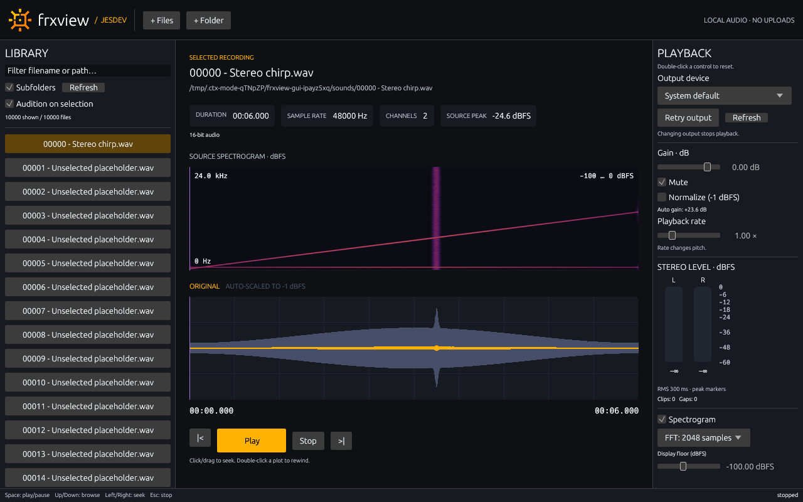

# frxview

A compact, CLI-first Rust audio browser with a **native desktop GUI**.

Browse local recordings in place, inspect metadata, audition WAV/MP3, seek, normalize peaks, change gain/rate, and generate cached waveform/spectrogram overviews. Source audio is never modified. Both interfaces use the same core and audio APIs.

## Build

Rust 1.89+ is declared by the dependency graph; **locally verified with Rust 1.95 on Linux**. Windows/macOS support is intended through CPAL, but not yet built or runtime-tested.

```sh
# Debian/Ubuntu native build dependencies
sudo apt install build-essential pkg-config libasound2-dev
cargo build --release --locked
./target/release/frxview --help
```

The CLI binary is `target/release/frxview` (`frxview.exe` on Windows). Plain `cargo build`/`cargo run` still target the CLI only; build the whole workspace or select the GUI explicitly. Python and FFmpeg are optional test tools, not application runtime dependencies.

## Desktop app

```sh
cargo run --release -p frx-gui --features spectrogram -- /path/to/recordings
# Or build both binaries with spectral analysis enabled:
cargo build --release --workspace --features spectrogram --locked
./target/release/frxview-gui
```

- **Left:** virtualized, filterable file list, recursive browsing and optional audition-on-selection. Use **+ Files**, **+ Folder**, the **File** menu, drag-and-drop, or startup paths to import. First selection on startup does not auto-play.
- **Center:** metadata cards (including the DC offset in dBFS), waveforms first (DC-removed, with a subdued −1 dBFS normalized overlay), then optional source spectrogram(s), click/drag seeking, right-click timestamp markers, symbol transport buttons (▶ play, ❚❚ pause, ■ stop, ⏮/⏭ browse), and two bottom rows — the annotation field and the live spectrum — separated by a horizontal resize bar.
- **Stereo views:** waveform and spectrogram each get a **Left / Right / Both** selector and are grouped as WAVE L, WAVE R, SPEC L, SPEC R (stereo recordings only).
- **Resizable/zoomable plots:** drag a plot's bottom edge to resize it; zoom any subsection to full width with the −/+ buttons or the scroll wheel over a plot — all waveforms and spectrograms share the zoom window, and seeking/playhead/markers/time readout follow it. Double-click a plot rewinds and resets the zoom.
- **Live spectrum:** a toggleable magnitude-spectrum row at the bottom of the center area (log-frequency 1/3-octave grid, height-adaptive dB grid, highpass response curve when enabled), recomputed at the playhead while playing; its height trades off with the annotation row via the split bar.
- **Right:** output device, gain in dB, Normalize, pitch-changing rate, fixed highpass toggle, vertical stereo RMS/peak meters in dBFS, FFT size and spectral display floor, and a debug-console toggle.
- **Top bar:** File / Playback / View menus export the main CLI-equivalent actions.
- **Annotations:** type `[dd:hh:mm:ss] note` in the bottom field (Enter) or right-click a plot at a position; markers render as vertical lines and in the field and are idempotent. They stay **floating** until you save with **Ctrl+S** or **File → Save annotations**, which opens a standard save dialog (naming + overwrite warning) and writes them into the file's own metadata (WAV LIST/INFO, MP3 ID3v2) — the file stays a normal playable audio file. Switching files with unsaved annotations warns first (Save / Dismiss / Cancel).
- **Double-click to reset:** gain returns to 0 dB/unity and unmutes; rate to 1×; toggles, device and spectral settings to their defaults. Double-click a plot to rewind.
- **Keys:** Space play/pause; Up/Down browse visible results; Left/Right seek five seconds; Esc stop. Shortcuts do not intercept text entry.
- **JESDEV theme:** dark compact panels, amber waveform/actions, purple playhead, teal annotation markers, bundled logo with provenance.

Sessions are stateless: opening files/folders replaces the current roots, Refresh rescans them, and nothing is restored on restart. Analysis caches are temporary by default. `--cache DIR` explicitly retains analysis artifacts for diagnostics; deprecated `--library` is ignored. Overlapping roots are deduplicated and displayed candidates are capped at 100,000, with an explicit warning. Device switches stop playback. Output failure does not prevent browsing or analysis. `--muted` starts at gain zero.

On Linux the GUI uses egui/eframe with OpenGL and X11/Wayland runtime libraries; file dialogs use the desktop portal (`xdg-desktop-portal` plus a desktop-specific backend). It compiled here without additional GUI development headers. Drag-and-drop and startup paths remain alternatives if a desktop portal is unavailable. Windows/macOS native builds and dialogs remain unverified.

The `spectrogram` Cargo feature is optional; omit it for a waveform-only build. Feature builds show the spectrogram by default. See [GUI design, tests and limitations](docs/gui.md) and [level/normalization/spectral conventions](docs/analysis.md).



## Quick start

```sh
# Import validates and prints canonical roots; it does not persist a library.
./target/release/frxview import /path/to/recordings
./target/release/frxview list --recursive

# You can also browse/play without importing first.
./target/release/frxview list /path/to/recordings --recursive
./target/release/frxview inspect '/path/to/recording.wav'
./target/release/frxview devices
./target/release/frxview play '/path/to/recording.wav' --gain 0.5
./target/release/frxview play '/path/to/recording.mp3' --rate 1.5 --seconds 10
./target/release/frxview waveform '/path/to/recording.wav'
./target/release/frxview normalization '/path/to/recording.wav'
./target/release/frxview play '/path/to/recording.wav' --normalize --gain-db -6
./target/release/frxview play '/path/to/recording.wav' --highpass
./target/release/frxview spectrogram '/path/to/recording.wav' --fft-size 2048
./target/release/frxview levels '/path/to/recording.wav'
./target/release/frxview waveform '/path/to/recording.wav' --stereo
./target/release/frxview annotate '/path/to/recording.wav' '[00:00:12:00] thunder'
./target/release/frxview annotate '/path/to/recording.wav' --seconds 42 'clap'
./target/release/frxview annotate '/path/to/recording.wav' --output '/path/copy.wav' '[00:00:12:00] thunder'
./target/release/frxview annotations '/path/to/recording.wav'
./target/release/frxview spectrum '/path/to/recording.wav' --position 12.5
./target/release/frxview waveform '/path/to/recording.wav' --from 10 --to 20
```

- Results are JSON; `list` emits one JSON object per file. Application errors go to stderr with a nonzero exit code; Clap usage errors use its standard text output.
- Listing filters by extension; `inspect` and `play` validate the codec/container. Nested directories require `--recursive`; `--sort` enables alphabetical order within each directory. Directory symlinks are not followed. Overlapping imported roots can yield duplicate listing entries.
- `list` without a path browses the working directory, never a saved library. `import` only validates/emits roots; it does not retain them.
- Waveforms use an automatically removed temporary cache; explicitly retain artifacts with `waveform --cache DIR`. `--bins` accepts powers of two from 2 to 65536. The cache budget is 64 MiB and eviction only touches frxview-owned entries.
- Manual gain accepts linear `--gain` (0–4, 1 is unity) or `--gain-db`. Output is clamped to [-1, 1] and clipped samples are counted.
- `--normalize` applies linked-channel sample-peak gain to reach −1 dBFS **before manual gain**, computed on the **DC-removed** signal. It preserves stereo balance and leaves silence unchanged. This is not loudness/true-peak normalization. The CLI computes or loads peak analysis before starting; the GUI waits without blocking its event loop and never starts normalized playback at an unanalysed gain.
- Playback always removes DC offset with a one-pole DC blocker and applies a short onset/offset fade (anti dirac-pop). `--highpass` additionally enables a fixed 20 Hz highpass against infra-sound. `levels` reports the per-channel DC offset in linear and dBFS, raw and DC-removed peaks, and the normalization. `benchmark --highpass` applies the same chain.
- `waveform --channel N` / `--stereo` select per-channel overviews; `spectrogram --channel N` / `--stereo` do the same for spectral analysis.
- `annotate` merges `[dd:hh:mm:ss]` markers (or `--seconds`) into the file's own metadata (WAV LIST INFO / MP3 ID3v2) atomically, without altering the audio data; identical annotations are never duplicated. `--output DST` saves an annotated copy instead of modifying the source (the GUI save-dialog equivalent). `annotations` lists them. Both are also session ops. In the GUI, markers are floating until saved via Ctrl+S / the File menu; switching files with unsaved markers warns first.
- `spectrum` (feature `spectrogram`) returns one calibrated magnitude spectrum in dBFS at `--position`; `waveform`/`spectrogram` accept `--from/--to` zoom windows. Global `--verbose` pipes console log lines to stderr as JSON (headless counterpart of the GUI debug console).
- `spectrogram` requires its Cargo feature. The CLI returns the same calibrated, bounded STFT overview used by the GUI; its separate 64 MiB cache is temporary unless `--cache DIR` is supplied.
- Rate is 0.25–4 and **changes pitch**. Linear interpolation is a preview implementation, not antialiased resampling or pitch-preserving time stretching.
- Use `--device INDEX` on `play` or `session` to choose an output. Indices come from `devices` and may change when hardware changes. The device's default sample rate/channel count is used; a small supported output buffer is requested.

## Persistent control session

```sh
./target/release/frxview session
```

Reads one JSON object per line from stdin and replies with one JSON object per line on stdout. Paths containing spaces need only normal JSON quoting. Send these interactively or from a process controlling stdin/stdout:

```json
{"op":"play","path":"/path/to/recording.wav"}
{"op":"status"}
{"op":"seek","seconds":12.5}
{"op":"rate","value":1.5}
{"op":"gain","value":0.5}
{"op":"pause"}
{"op":"resume"}
{"op":"stop"}
{"op":"highpass","enabled":true}
{"op":"annotate","path":"/path/to/recording.wav","text":"[00:00:12:00] thunder"}
{"op":"annotations","path":"/path/to/recording.wav"}
{"op":"quit"}
```

The initial reply is `{"event":"ready","protocol":1}`. Transport commands acknowledge **acceptance, not completion**. Poll `status` to observe errors, position, and state. `generation` changes as the worker applies play/seek/rate/stop; `rendered_generation` changes when frames from that generation reach the output callback. It is not DAC/audible latency. Consecutive queued play/seek commands may coalesce. Pause and gain apply immediately; changing selection preserves pause.

Use `normalization PATH` to obtain the actual DC-removed source peak, then send `{"op":"play_normalized","path":"/path/to/recording.wav","peak":0.5}` with that measured peak (0.5 here is only an example). For the current file, `{"op":"normalize","path":"/path/to/recording.wav","peak":0.5}` changes normalization without a seek; `"peak":null` disables it. The path guard rejects stale analysis for a different recording. Ordinary `play` resets normalization. Manual/session `gain` remains linear for compatibility; status additionally reports gain in dB, normalization gain, the highpass state and per-channel RMS/peak dBFS (`null` for zero).

A missing/corrupt file produces an asynchronous error in status; a later successful play clears it. Device stream failures require reopening the session. Invalid commands produce an error reply without ending the session. Requests are limited to 64 KiB. EOF or `quit` stops the engine; **piping play then immediately quit does not wait for playback**. Use the one-shot `play` command for that.

## Architecture

| Crate | Responsibility |
|---|---|
| `frx-core` | Discovery, decoding/metadata, level conventions, waveform and optional spectral caches |
| `frx-audio` | Typed transport, deterministic renderer, decoder worker, CPAL callback |
| `frx-cli` | Clap and JSON-lines adapters |
| `frx-gui` | egui views, background adapters, generation-aware browser/analysis state |

Audio streams through an 8192-frame SPSC ring. Decoding, resampling, file opening, and seeking run on a worker; the callback does no disk I/O, decoding, allocation, logging, or mutex locking. Old-generation frames are discarded after seek/switch. Whole recordings are not loaded into memory.

See [architecture](docs/architecture.md), [references and branding](docs/references.md), and [remaining work](docs/roadmap.md). `goal.md` is the user-maintained brief and is never edited by implementation work. Production tuning constants live in each crate's `src/config.rs`; GUI colors live in `theme.rs`.

## Test and measure

```sh
cargo fmt --all -- --check
cargo clippy --workspace --all-targets --features spectrogram --locked -- -D warnings
cargo test --workspace --features spectrogram --locked
cargo test --workspace --no-default-features --locked
cargo build --release --workspace --features spectrogram --locked
./target/release/frxview benchmark '/path/to/recording.wav'
python3 scripts/check-performance.py
python3 scripts/check-performance.py --audio --spectrogram  # MUTED real-device smoke test
python3 scripts/check-gui.py --expect-spectrogram --demo --screenshot /tmp/frxview.png  # needs a display
```

Unit/integration tests do not require an audio device. WAV fixtures are generated in temporary directories; the tiny synthetic MP3 fixture is committed with its generation command. The performance script generates 60-second and 600-second WAVs and 10,000 directory entries, then removes them. FFmpeg is optional and enables an additional generated MP3 benchmark. The optional device test uses POSIX pipe polling, gain zero, and never deliberately plays the synthetic tone audibly.

[Measured baseline and caveats](docs/performance.md). These tests establish a foundation—not proof that every codec, driver, or slow filesystem is glitch-free.

## Current limitations

- A separate magnitude-spectrum panel, waveform zoom and persisted preferences remain work. The meter has a 300 ms exponential RMS envelope and decaying sample peaks; it is VU-style, **not an IEC-calibrated VU instrument**. Annotation metadata writing supports WAV and MP3; other formats report a clear error and are left untouched.
- Spectrograms are bounded, linearly spaced frequency overviews with maximum aggregation, not a zoomable analysis editor or power spectral density measurement.
- Playback supports mono/stereo; multichannel metadata/waveforms work, but auditioning >2 channels is rejected. Extra device channels are silent.
- WAV and MP3 are tested. Other Symphonia-enabled formats may work but are not yet qualified. A truncated stream ending at a valid packet boundary may look like normal EOF; this is not an audio-file integrity checker.
- Current-file read-ahead and a bounded overview cache exist. Next-file preloading and progressive multiresolution waveforms remain work.
- GUI discovery/analysis run on separate workers with cooperative cancellation and stale-result rejection. OS file reads, directory enumeration/sorting and device opening cannot be interrupted; a newer request may wait for one already in progress, but not on the UI thread. CLI analysis remains an explicit job.
- Cache identity uses path/size/mtime, not a full content hash. If files change while preserving both size and mtime, delete their cached analyses.
- Cross-platform release packaging, dependency/security audits, and application licensing still need decisions. No remote is configured.
