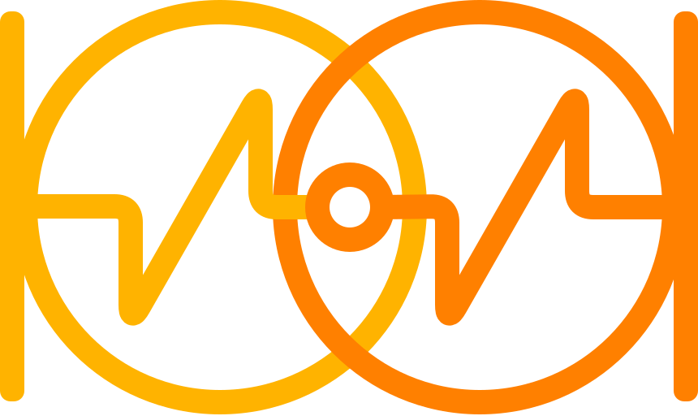
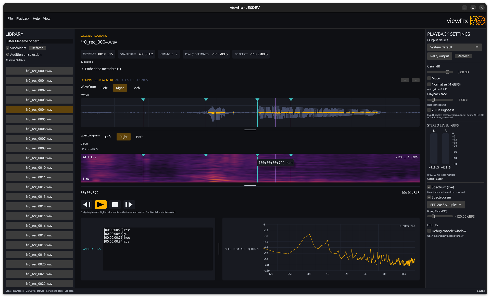

# viewfrx

> [!IMPORTANT]
> This is vibe-coded. See the [**AI use policy**](AI_POLICY.md) for details.

  

**Find the right sound. Keep your flow.**

A compact audio browser for field recordings, foley, and folders full of sounds. Browse in place, see the waveform, and jump straight to the moment you want—without importing everything into a library. Built in Rust, with a native desktop app and a CLI.

## [⬇ Downloads — Linux · Windows · macOS](https://github.com/jesdev-io/viewfrx/releases/latest)

Get an installer or portable archive from the **[latest release](https://github.com/jesdev-io/viewfrx/releases/latest)**. No Rust toolchain required. See the [installation guide](docs/installation.md) for package choices, platform requirements, and building from source.

Windows and macOS installers are currently unsigned and may show security warnings.

## Quick start

1. **Install and open viewfrx** (or extract a portable archive and launch `viewfrx-gui`).
2. **Drop in files or a folder**, or choose **File → Import files/folder**. WAV and MP3 are tested.
3. **Select a recording and press Space** to play or pause. Click the waveform to seek; use Up/Down to browse and Left/Right to jump five seconds.
4. **Mark what matters.** Right-click a plot to add a timestamp note. Press **Ctrl+S** to save annotations into the audio file’s metadata; nothing is written until you save.

No catalog to manage: opening files or folders replaces the current session, and preferences are not restored on restart.

## What you can do

- **Browse without the baggage.** Filter a virtualized file list, explore folders recursively, and optionally audition on selection.
- **See the sound.** Inspect metadata, stereo waveforms, a live spectrum, and optional spectrograms with linked zoom and seeking.
- **Audition with control.** Adjust gain and playback rate, toggle peak normalization or a highpass filter, and choose your output device. Rate changes also change pitch.
- **Keep notes with the recording.** Timestamp annotations save inside WAV/MP3 metadata—no sidecar database, and the audio stays playable in other apps.
- **Use the terminal, too.** The included `viewfrx` CLI handles browsing, playback, analysis, and annotations, with a control session for automation. See the [CLI guide](docs/cli.md).

## Learn more

**[Documentation](docs/README.md)** · [Desktop guide](docs/desktop-guide.md) · [CLI guide](docs/cli.md) · [Changelog](CHANGELOG.md) · [Known limitations](docs/limitations.md)

> **Agents: start here.** Read the [project brief](goal.md) (owner-maintained; do not edit), [architecture contracts](docs/architecture.md), [DSP and level conventions](docs/analysis.md), and [GUI design and test boundaries](docs/gui.md). Use the [development guide](docs/development.md) for testing and release rules; check the [roadmap](docs/roadmap.md) before treating planned work as implemented.
