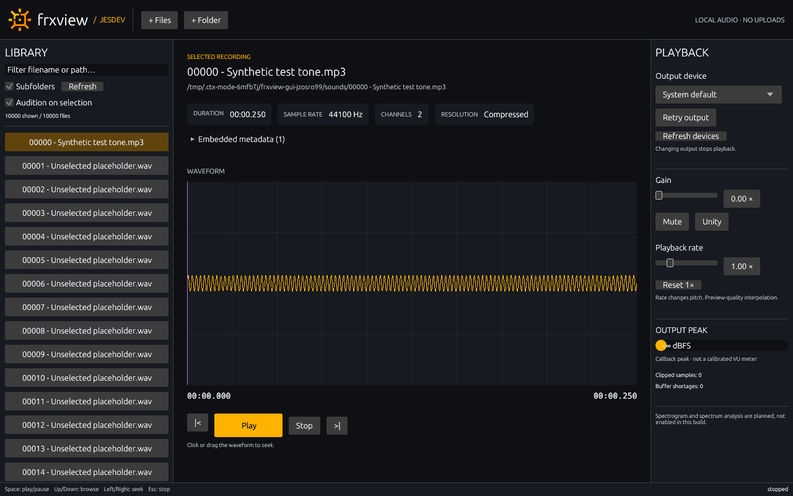

# Native desktop milestone



Actual Linux framebuffer capture from the muted smoke test, not a mockup.

## Choice and scope

The GUI uses **egui/eframe 0.33 with Glow/OpenGL**, not a browser shell. It fits the existing Rust architecture, supports custom waveform painting and virtualized lists, and does not require moving application logic into a JavaScript frontend. WGPU was not needed for a bounded waveform overview. `rfd` provides file/folder dialogs; Linux uses the desktop portal. This is a pragmatic selection, not a benchmark proving egui faster than every alternative.

References checked:
- https://docs.rs/eframe/0.33.3/eframe/
- https://docs.rs/rfd/0.15.4/rfd/
- JESDEV source CSS/logo inventory in [references.md](references.md).

The bundled logo is copied unchanged from the requested sibling repository. Its provenance is in `crates/frx-gui/assets/README.md`. No new asset license is invented.

## Run

```sh
cargo run --release -p frx-gui -- /path/to/recordings
# Separate catalog, if desired:
./target/release/frxview-gui --library /tmp/frx-library.json --cache /tmp/frx-cache /path/to/audio
# Silent initial gain (can still be changed in the UI):
./target/release/frxview-gui --muted
```

Imports register source paths in place. Initial discovery selects the first file for metadata/waveform inspection without starting playback. Clicking a file or using Up/Down auditions it when the checkbox is enabled. Native chooser operations run off-thread; startup paths and drag/drop avoid reliance on a desktop portal.

GUI defaults to recursive traversal, alphabetical order within each directory and result deduplication; CLI defaults remain unchanged. `frxview list --sort --recursive` exposes the ordered traversal headlessly. Filtering searches filenames and full paths. Keyboard selection scrolls into view. The list displays at most 100,000 candidates; it reports the limit rather than silently claiming a complete listing.

Settings cover output selection/retry, gain 0–2×, playback rate 0.25–4×, and a callback peak in dBFS. CLI gain still supports 0–4×. Device changes stop the current stream; press Play after the replacement is ready. Buffer/rate configuration and stable persistent device IDs are still pending. The meter is explicitly **not** a calibrated VU meter. Rate adjustment explicitly changes pitch and uses the existing preview interpolation.

## Worker boundaries

- **Audio service:** owns CPAL/Engine on its own thread; typed commands in, latest status out. Device discovery/open/drop never runs in egui `update()`.
- **Library worker:** loads/saves the shared catalog, performs sorted traversal, deduplicates and emits bounded batches. New scans supersede old ones; queued imports remain additive.
- **Analysis worker:** probes the selected file first, then generates/loads its waveform. Every response carries a selection generation. Cancelled work cannot replace a newer file's UI state or persist a partly generated waveform.
- **Views:** model/filter/navigation, virtualized list rendering and bounded waveform painting. No source decoding or filesystem traversal in widgets.

Per-directory sorting and OS reads may still take time before cancellation is noticed. The UI remains independent, but a new analysis can wait behind an in-flight read on the analysis worker. Query filtering is currently a synchronous in-memory pass over up to 100,000 cached path strings; further performance work should measure real long-path collections rather than extrapolate from the smoke fixture.

## Verification

```sh
cargo fmt --all -- --check
cargo clippy --workspace --all-targets --locked -- -D warnings
cargo test --workspace --locked
cargo build --release --workspace --locked
python3 scripts/check-gui.py --screenshot /tmp/frxview.png
python3 scripts/check-performance.py --audio
```

The standard suite has **26 tests** at this milestone. Added coverage includes:
- Filtering across incoming batches and navigation through visible results.
- Input validation for timeline mapping.
- Actual egui pointer input on the waveform and Space-key routing to shared transport commands.
- Empty/populated views at 1280×800 and 900×560 with no audio device.
- Sorted/deduplicated background discovery, latest-selection metadata/waveform ordering and cancellation under result-queue backpressure.
- Mid-analysis cancellation without writing a partial cache entry.

The native smoke launches an actual window, uses temporary sources/catalog/cache, renders 10,000 candidates and a real decoded MP3 waveform, captures a real framebuffer PNG and closes automatically. It starts muted and does not trigger playback. The screenshot was visually inspected. [Raw run](gui-baseline.json): all 10,000 candidates loaded, 143 UI updates, largest measured `update()` CPU duration ~0.98 ms. This excludes GPU rendering, OS scheduling, window creation and screenshot encoding; it is **not** a frame-latency guarantee. Total process duration was ~9.2 s including the deliberate three-second hold, native startup, capture and teardown. A repeat also passed (~0.75 ms max update CPU, ~8.9 s total).

The separate muted CPAL regression passed after these changes: WAV/MP3 playback, seeking, pause/resume, rate control, EOF and file-error recovery; no additional shortages during its one-second steady-playback observation. This is not sustained-load testing or subjective listening.

Linux startup emitted ALSA/JACK enumeration warnings for unavailable optional devices; the default output remained usable. Native chooser interaction, drag/drop interaction, accessibility, HiDPI behavior and Windows/macOS runtime behavior have **not** been end-to-end verified.

## Diagnostics

`--smoke-seconds N` (1–120) prints a JSON UI summary and closes automatically. With `--screenshot PATH.png`, it captures the rendered window before exiting; capture failure/timeout exits nonzero. These diagnostics exercise the normal application and do not substitute fabricated waveform data. `scripts/check-gui.py` requires a display; on a configured CI machine it can be wrapped with `xvfb-run`.

## Remaining work

No spectrogram, magnitude spectrum, annotation editor, calibrated VU ballistics, waveform zoom/pan, pitch-preserving stretching or persisted playback settings yet. No claim of glitch-free operation on network drives or every audio driver. The backend limitations in [roadmap.md](roadmap.md) still apply.
